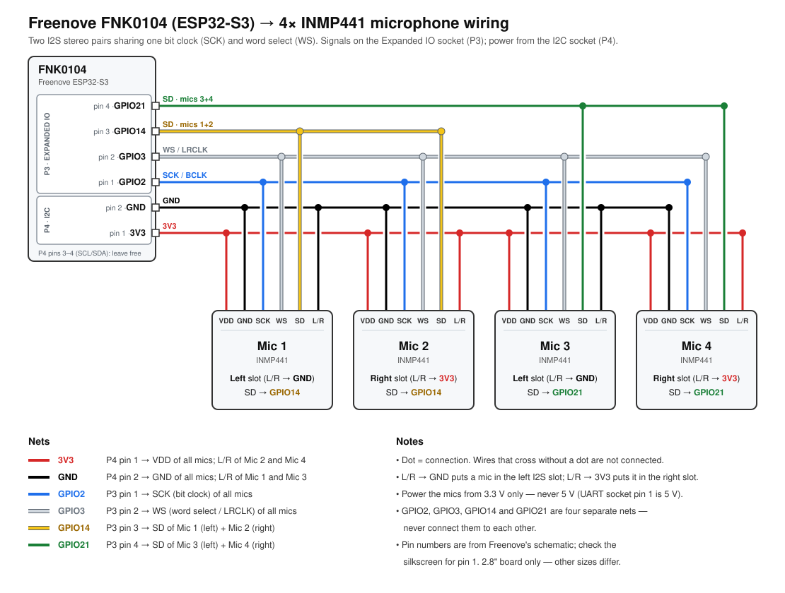

# EarWing - Cloud free private transcription


Earwing is a 3D printable beam-forming microphone array and transcription tool. It offloads transcription and meeting note generation to browser-hosted, private models and uses a ESP32 dev board to display meeting notes on the device. 

This keeps it entirely cloud-free and self-hosted. 

<video src="https://github.com/user-attachments/assets/d39d0901-3504-4cc0-952a-e442f727ea81" width="1280" height="720" controls></video>


## Hardware

* Freenove FNK0104 Devboard.
  * [Docs](https://docs.freenove.com/projects/fnk0104/en/latest/fnk0104/codes/MAIN/Freenove_ESP32S3_Display.html)
  * [Amazon link](https://www.amazon.com/dp/B0FSQF6FKN)
* 4x INMP441 microphones

## Installation

### Build the hardware

* Print the 3d Print from ./3dprint
* Wire the four INMP441 microphones to the ESP32:



### Flash the firmware onto the ESP32

The firmware and the web UI served by the ESP32 are flashed separately. You need
to upload both for the first installation.

1. Install [PlatformIO Core](https://docs.platformio.org/en/latest/core/installation/methods/installer-script.html)
   and Node.js 22 with npm. Make sure `pio`, `node` and `npm` are available in your
   terminal. If `pio` is missing after installation, follow PlatformIO's
   [shell setup instructions](https://docs.platformio.org/en/latest/core/installation/shell-commands.html).
2. Connect the Freenove FNK0104 to your computer through its native USB port using
   a USB data cable.
3. From the repository root, build and upload the firmware:

   ```sh
   pio run -d code -e fnk0104 -t upload
   ```

   PlatformIO downloads the toolchain and libraries on the first build. The board,
   flash and PSRAM settings are already configured in `code/platformio.ini`.
4. Build and upload the web UI:

   ```sh
   cd site
   npm ci
   npm run build:device
   pio run -d ../code -e fnk0104 -t uploadfs
   cd ..
   ```

   `build:device` builds the site and packs it into `code/data/`. `uploadfs` uploads
   that directory as a LittleFS image. For later web UI updates, `npm run deploy`
   from `site/` combines the build and filesystem upload; firmware changes still
   need the command in step 3.
5. Press RESET if the board does not restart after uploading. On a fresh
   installation, connect your computer or phone to the open **earwing** Wi-Fi
   network and visit `http://192.168.4.1/` if the setup page does not open
   automatically. Select your Wi-Fi network and enter its password.
6. Reconnect your computer to the same Wi-Fi network as the device, then open
   `https://earwing.local/`. The device uses a self-signed certificate; the status
   page at `/status` links to the certificate and trust instructions. The device's
   screen also shows its address. See [the web app README](site/README.md) for
   browser requirements and model setup.

**If uploading fails:** close any serial monitor and run `pio device list` to find
the board's port. PlatformIO normally detects it automatically, but you can specify
it with `--upload-port` on either upload command, for example from the repository
root:

```sh
pio run -d code -e fnk0104 -t upload --upload-port /dev/cu.usbmodemXXXX
pio run -d code -e fnk0104 -t uploadfs --upload-port /dev/cu.usbmodemXXXX
```

Replace the example port with your device's port (such as `/dev/ttyACM0` on Linux
or `COM3` on Windows). If the board does not enter download mode, hold **BOOT**,
press and release **RESET**, then release **BOOT** and retry the upload. Check the
port again after entering download mode, and press RESET after flashing to start
the firmware. This follows Espressif's [USB flashing procedure](https://docs.espressif.com/projects/arduino-esp32/en/latest/tutorials/cdc_dfu_flash.html).

For diagnostic output, run this from the repository root:

```sh
pio device monitor -d code -e fnk0104
```

The monitor uses the configured 115200 baud rate. Exit it with Ctrl+C before
uploading again. The device remembers up to five networks it has joined and
picks the strongest one it can hear at boot. **Settings → WiFi networks** on the
touchscreen lists them: tap one to join or forget it, or **Add** to reopen Wi-Fi
setup (holding BOOT for two seconds does the same). The `/status` page lists
them too, and can add a network or change a saved password.
